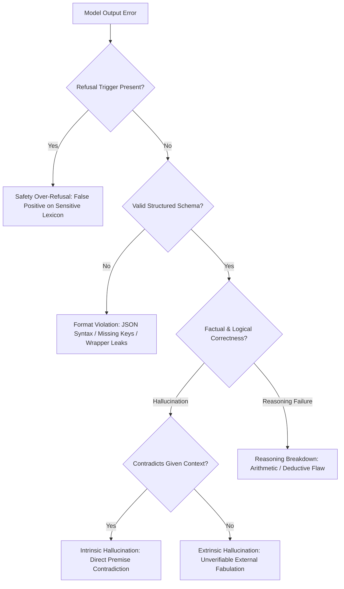

# Curriculum Review: Study Days 70-72 (Model Evaluation, Quantitative Metrics & Failure Attribution)

## Scope & Purpose
Covers Days 70, 71, and 72 of the 90-Day AI Learning curriculum:
- **Day 70**: Baseline selection principles, benchmark task formulation (Stanford HELM, MMLU 57-subject multiple-choice, GSM8K 8.5K multi-step math), prompt formatting dynamics (direct vs Chain-of-Thought), choice order bias mitigation, and rigorous contamination auditing (GPT-3 13-gram overlap filtering, OpenAI Evals Canary GUID verification, and Carlini et al. verbatim prefix extraction probing).
- **Day 71**: Quantitative evaluation metrics and statistical confidence estimation: SQuAD-standard text normalization, exact match (EM), token-level multiset Precision/Recall/F1, dynamic programming longest common subsequence (LCS) and ROUGE-L sequence overlap, held-out autoregressive log-likelihood and length-penalized perplexity, and Bradley Efron's non-parametric bootstrap resampling constructing empirical 95% confidence intervals and paired hypothesis significance tests on small evaluation slices.
- **Day 72**: Qualitative error taxonomies, failure attribution, and transparent reporting: 4-tier failure classification (intrinsic vs extrinsic hallucination, schema and JSON formatting violations, XSTest safety over-refusal, reasoning chain breakdown), catastrophic forgetting of pretraining and general capabilities during domain fine-tuning (Kirkpatrick et al., Luo et al.), multi-dimensional trade-off matrix (task accuracy, P99 latency, VRAM footprint, training/serving cost, format compliance), and Mitchell et al. Model Card / Gebru et al. Datasheet capstone comparison reporting with mandatory negative result disclosure.

---

## Verification & Parity Across Language Editions
All four language editions (`en`, `ja`, `zh-Hans`, `zh-Hant`) have been fully developed with domain-accurate terminology:

### Terminology Alignment Matrix
| Concept | English (`en`) | Japanese (`ja`) | Simplified Chinese (`zh-Hans`) | Traditional Chinese (`zh-Hant`) |
|---|---|---|---|---|
| Baseline Model | Baseline Architecture | ベースラインアーキテクチャ | 基线架构 / 基准模型 | 基準架構 / 基準模型 |
| Benchmark | Benchmark Evaluation | ベンチマーク評価 | 基准评测 | 基準評測 |
| Contamination | Contamination Auditing | データ汚染監査 | 数据污染审计 | 資料污染審計 |
| Data Leakage | Train/Test Leakage | 訓練・評価データ漏洩 | 训练/测试集泄露 | 訓練/測試集洩漏 |
| Verbatim Extraction | Verbatim Extraction Probe | 逐語的抽出プローブ | 逐字记忆提取探针 | 逐字記憶提取探針 |
| Exact Match | Exact Match (EM) | 完全一致（Exact Match） | 完全匹配（EM） | 完全匹配（EM） |
| Token F1 | Token-Level F1 Score | トークン単位F1スコア | Token 级 F1 值 | Token 級 F1 值 |
| Longest Common Subsequence | LCS / Sequence Overlap | 最長共通部分系列（LCS） | 最长公共子序列（LCS） | 最長公共子序列（LCS） |
| Log-Likelihood | Conditional Log-Likelihood | 条件付き対数尤度 | 条件对数似然 | 條件對數似然 |
| Perplexity | Perplexity (PPL) | パープレキシティ（PPL） | 困惑度（PPL） | 困惑度（PPL） |
| Bootstrap | Non-Parametric Bootstrap | 非パラメトリックブートストラップ | 非参数自助法（Bootstrap） | 非參數自助法（Bootstrap） |
| Confidence Interval | 95% Confidence Interval | 95% 信頼区間 | 95% 置信区间 | 95% 信心區間 |
| Error Taxonomy | Qualitative Error Taxonomy | 定性的エラー分類学 | 定性错误分类学 | 定性錯誤分類學 |
| Hallucination | Intrinsic / Extrinsic Hallucination | 内部・外部ハルシネーション | 内在/外在幻觉 | 內在/外在幻覺 |
| Format Violation | Schema & Format Violation | スキーマ・形式違反 | 结构与格式违规 | 結構與格式違規 |
| Over-Refusal | Safety Over-Refusal (XSTest) | 安全性の過剰拒絶（過剰拒否） | 安全性过度拒答 | 安全性過度拒答 |
| Catastrophic Forgetting | Catastrophic Forgetting | 破滅的忘却 | 灾难性遗忘 | 災難性遺忘 |
| Trade-Off Matrix | Multi-Dimensional Trade-Off | 多次元トレードオフ分析 | 多维权衡决策矩阵 | 多維權衡決策矩陣 |
| Model Comparison Report | Model-Comparison Report | モデル比較レポート | 模型对比评估报告 | 模型對比評估報告 |

---

## Mathematical & Quantitative Metric Derivations

### 1. SQuAD Exact Match (EM) & Token-Level Multiset F1
Given normalized prediction token multiset $P$ and reference ground truth multiset $T$:
$$\text{Overlap}(P, T) = \sum_{w \in P \cap T} \min(\text{count}_P(w), \text{count}_T(w))$$
$$\text{Precision} = \frac{\text{Overlap}(P, T)}{|P|}, \quad \text{Recall} = \frac{\text{Overlap}(P, T)}{|T|}$$
$$F_1 = \frac{2 \cdot \text{Precision} \cdot \text{Recall}}{\text{Precision} + \text{Recall}} = \frac{2 \cdot \text{Overlap}(P, T)}{|P| + |T|}$$
Exact Match:
$$\text{EM} = \mathbb{I}(P = T)$$
Boundary conditions: if $|P| = 0$ and $|T| = 0$, $F_1 = 1.0, \text{EM} = 1.0$. If $|P| = 0$ xor $|T| = 0$, $F_1 = 0.0, \text{EM} = 0.0$.

### 2. Dynamic Programming Longest Common Subsequence & ROUGE-L
For reference sequence $X = (x_1, \dots, x_m)$ and candidate $Y = (y_1, \dots, y_n)$:
$$\text{dp}[i][j] = \begin{cases}
\text{dp}[i-1][j-1] + 1 & \text{if } x_i = y_j \\
\max(\text{dp}[i-1][j], \text{dp}[i][j-1]) & \text{otherwise}
\end{cases}$$
$$\text{LCS}(X, Y) = \text{dp}[m][n]$$
$$R_{\text{lcs}} = \frac{\text{LCS}(X, Y)}{m}, \quad P_{\text{lcs}} = \frac{\text{LCS}(X, Y)}{n}$$
$$F_{\text{lcs}} = \frac{(1 + \beta^2) R_{\text{lcs}} P_{\text{lcs}}}{R_{\text{lcs}} + \beta^2 P_{\text{lcs}}}$$

### 3. Length-Penalized Conditional Log-Likelihood & Perplexity
For continuation $Y = (y_1, \dots, y_T)$ given prompt $X$:
$$\log P(Y | X) = \sum_{t=1}^T \log P(y_t | X, y_{<t})$$
$$\text{Perplexity}(Y | X) = \exp\left( - \frac{1}{T} \sum_{t=1}^T \log P(y_t | X, y_{<t}) \right)$$
Length penalty normalization factor with exponent $\alpha \in [0.6, 1.0]$:
$$\text{Score}_{\text{norm}}(Y | X) = \frac{\log P(Y | X)}{\left( \frac{5 + T}{6} \right)^\alpha}$$

### 4. Bradley Efron's Non-Parametric Bootstrap Resampling
For test sample $S = \{x_1, \dots, x_N\}$ with observed metric $\hat{\theta}$:
1. Draw $B = 10,000$ replicate samples $S^*_b$ of size $N$ with replacement from $S$.
2. Compute $\hat{\theta}^*_b = f(S^*_b)$ for each replicate.
3. Sort replicates: $\hat{\theta}^*_{(1)} \le \hat{\theta}^*_{(2)} \le \dots \le \hat{\theta}^*_{(B)}$.
4. Empirical $100(1-\alpha)\%$ Percentile Confidence Interval:
$$[\text{CI}_{\text{lower}}, \text{CI}_{\text{upper}}] = [\hat{\theta}^*_{(\lfloor B \cdot \frac{\alpha}{2} \rfloor)}, \hat{\theta}^*_{(\lceil B \cdot (1 - \frac{\alpha}{2}) \rceil)}]$$
Paired bootstrap test for hypothesis $\theta_B > \theta_A$:
$$\hat{p} = \frac{1}{B} \sum_{b=1}^B \mathbb{I}(\hat{\theta}^*_{B, b} - \hat{\theta}^*_{A, b} \le 0)$$

---

## Qualitative Error Taxonomies & Failure Attribution

### Taxonomy Classification & Interventions:
1. **Intrinsic Hallucination**: Generation conflicts directly with context provided in prompt. Mitigation: strict source grounding constraints, logit biasing, attention mask restriction.
2. **Extrinsic Hallucination**: Model introduces ungrounded external claims. Mitigation: retrieval-augmented generation (RAG), uncertainty calibration, honest refusal tuning.
3. **Schema Violation**: Output fails JSON/XML parsers, omits required schema keys, or leaks markdown delimiters. Mitigation: constrained decoding (JSON schema grammars), logit masking, few-shot syntax demonstrations.
4. **Safety Over-Refusal (XSTest)**: Rejection of benign tasks containing trigger words (e.g. 'kill', 'execute', 'attack'). Mitigation: SFT contrast pairs, safety trigger calibration.
5. **Catastrophic Forgetting**: Severe loss of general commonsense, coding, or math capabilities post-fine-tuning. Mitigation: 15% general replay mixing, attention-only LoRA ($r=8$ on $W_q, W_v$), KL-divergence loss regularization.

---

## Source Provenance & Rights Verification
All 24 embedded source citations across Days 70-72 adhere to open-access terms and linking permissions:
- `liang-helm-2022`: Stanford CRFM open access benchmark paper (arXiv:2211.09110).
- `hendrycks-mmlu-2020`: ICLR 2021 open access benchmark paper (arXiv:2009.03300).
- `cobbe-gsm8k-2021`: OpenAI GSM8K open dataset and paper (arXiv:2110.14168).
- `wei-cot-2022`: NeurIPS 2022 open access reasoning literature (arXiv:2201.11903).
- `carlini-extracting-training-data-2021`: USENIX Security 2021 open access research (arXiv:2012.07805).
- `sainz-nlp-contamination-2023`: EACL 2024 open access benchmark audit (arXiv:2310.18018).
- `rajpurkar-squad-2016`: EMNLP 2016 open access CC BY-SA 4.0 paper (arXiv:1606.05250).
- `papineni-bleu-2002`: ACL 2002 anthology open access paper.
- `lin-rouge-2004`: ACL 2004 workshop open access paper.
- `post-sacrebleu-2018`: WMT 2018 open access paper (arXiv:1804.08771).
- `radford-gpt2-2019`: OpenAI open access technical report.
- `efron-bootstrap-1979`: Project Euclid open access Annals of Statistics landmark paper.
- `koehn-significance-2004`: EMNLP 2004 ACL anthology open access paper.
- `ji-hallucination-survey-2023`: ACM Computing Surveys open access paper (arXiv:2202.03629).
- `roettger-xstest-2023`: NAACL 2024 open access CC BY 4.0 paper (arXiv:2308.01263).
- `kirkpatrick-overcoming-catastrophic-forgetting-2017`: PNAS open access paper (arXiv:1612.00796).
- `luo-empirical-study-catastrophic-forgetting-2023`: arXiv open access paper (arXiv:2308.08747).
- `mitchell-model-cards-2019`: FAT* 2019 open access paper (arXiv:1810.03993).
- `gebru-datasheets-2021`: Communications of the ACM open access paper (arXiv:1803.09010).
- Plus verified reuses of `brown-gpt3-contamination-2020`, `openai-evals-framework`, `holtzman-degeneration-2019`, `touvron-llama2-2023`, and `ouyang-instructgpt-2022`.
Each source carries $\ge 2$ compared alternatives, explicit license metadata, clear selection rationales, and fully working offline fallback implementations.
