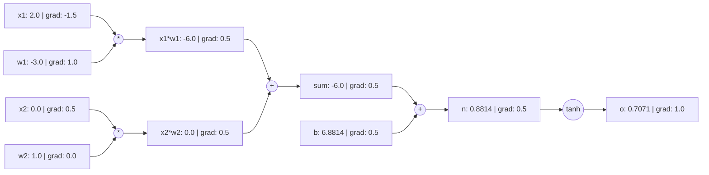

# Automatic Differentiation Learning Project Guide

**Language Edition:** English (`en`)  
**Project Slug:** `autograd-learning-project`  
**Command Seam:** `python3 projects/autograd/cli.py`

---

## 1. Core Concepts & Computational Graph

In deep learning, backpropagation is fundamentally **Reverse-Mode Automatic Differentiation**. By dynamically tracking operations during forward execution, the program constructs a **Directed Acyclic Graph (DAG)** of computational nodes.

### 1.1 Node Anatomy (`Value` Class)
Each computation node `Value` encapsulates:
- `data` (float): The forward scalar value.
- `grad` (float): The partial derivative of the scalar loss $L$ with respect to this variable ($\frac{\partial L}{\partial x}$), initialized to `0.0`.
- `_prev` (Set[Value]): Direct parent input nodes.
- `_op` (str): Identifier of the mathematical operation (e.g. `+`, `*`, `tanh`).
- `_backward` (Callable): Closure implementing the local chain rule step.



---

## 2. Mathematical Derivations & Operator Derivatives

The multivariable chain rule states that if variable $x$ influences subsequent nodes $y_1, y_2, \dots, y_k$, and the ultimate target loss is $L$:
$$\frac{\partial L}{\partial x} = \sum_{j=1}^{k} \frac{\partial L}{\partial y_j} \frac{\partial y_j}{\partial x}$$

This is why reverse-mode autodiff requires **gradient accumulation (`self.grad += ...`)**. If an implementer accidentally writes assignment (`=`), gradients along branching paths overwrite one another!

### Supported Operator Local Derivative Table

| Operation $f(x, y)$ | Forward Formula | Local Derivative $\frac{\partial f}{\partial x}$ | Local Derivative $\frac{\partial f}{\partial y}$ | Constraints & Domain |
|---|---|---|---|---|
| Addition $x + y$ | $x + y$ | $1$ | $1$ | None |
| Subtraction $x - y$ | $x - y$ | $1$ | $-1$ | None |
| Multiplication $x \cdot y$ | $x \cdot y$ | $y$ | $x$ | None |
| Division $x / y$ | $x \cdot y^{-1}$ | $\frac{1}{y}$ | $-\frac{x}{y^2}$ | Denominator $y \ne 0$ |
| Power $x^n$ | $x^n$ | $n x^{n-1}$ | — | Exponent $n \in \mathbb{R}$ |
| Exponential $\exp(x)$ | $e^x$ | $e^x$ | — | Avoid overflow for $x > 700$ |
| Natural Logarithm $\ln(x)$ | $\ln(x)$ | $\frac{1}{x}$ | — | Domain $x > 0$; raises `ValueError` otherwise |
| ReLU $\text{ReLU}(x)$ | $\max(0, x)$ | $\begin{cases} 1 & x > 0 \\ 0 & x \le 0 \end{cases}$ | — | Kink at $x=0$ (subgradient convention: $0$) |
| Tanh $\tanh(x)$ | $\frac{e^{2x}-1}{e^{2x}+1}$ | $1 - \tanh^2(x)$ | — | Stable range $[-20, 20]$ |

---

## 3. Independent Numerical Gradient Checking (Gradcheck)

### 3.1 Two-Sided Finite Difference Formula
$$\frac{\partial L}{\partial x} \approx \frac{L(x + h) - L(x - h)}{2h}$$
Compared to one-sided forward difference $\frac{L(x+h) - L(x)}{h}$ (truncation error $\mathcal{O}(h)$), central difference achieves $\mathcal{O}(h^2)$ truncation error.

### 3.2 Tolerance Policy
Floating-point computation (IEEE 754 float64) is bounded by truncation and rounding error:
$$\text{Relative Error} = \frac{|g_{\text{analytical}} - g_{\text{numerical}}|}{\max(|g_{\text{analytical}}|, |g_{\text{numerical}}|, \epsilon)} \le \text{rtol}$$
- Standard configuration: $h = 10^{-5}, \text{rtol} = 10^{-3}, \text{atol} = 10^{-5}, \epsilon = 10^{-7}$.

### 3.3 Non-Differentiable Points (Kink Disclosure)
For $\text{ReLU}$ at $x = 0.0$:
- Finite difference: $\frac{\max(0, h) - \max(0, -h)}{2h} = \frac{h - 0}{2h} = 0.5$.
- Analytical subgradient convention: $0.0$.
- This mismatch reflects a mathematical singularity (non-differentiable kink), not a bug. Gradcheck explicitly detects and discloses this condition.

---

## 4. Observable Failing-Gradient Diagnostic Demonstration

### Classic Flaw: Gradient Overwrite Bug
Consider the branching graph $f = (a + b) \cdot a$. Here, node $a$ contributes to both addition and multiplication.
If `_backward` is mistakenly implemented with assignment:
```python
# Deliberate Defect
def _backward():
    self.grad = 1.0 * out.grad  # Overwrites previously accumulated gradients!
```
Running the diagnostic command:
```bash
python3 projects/autograd/cli.py diagnose --bug-type overwrite-accumulation
```
The output pinpoints:
- Node `a` analytical gradient is $7.0$, while the numerical finite difference is $10.0$ ($30\%$ relative error).
- Root cause: Missing accumulation along multiple DAG branches.
- Suggested fix: Replace `=` with `+=`.

---

## 5. Exercises, Hints & Worked Answers

### Exercise 1: Hand Calculation vs Autograd
Given $f(x, y) = (x \cdot y + 2)^2$ at $x=1.5, y=-2.0$, calculate gradients by hand.
- **Hint**: Let $u = x \cdot y + 2$, so $f = u^2$. Apply $\frac{\partial f}{\partial u}$ and $\frac{\partial u}{\partial x}$.
- **Worked Answer**:
  $u = 1.5 \times (-2.0) + 2 = -1.0$.
  $f = (-1.0)^2 = 1.0$.
  $\frac{\partial f}{\partial u} = 2u = -2.0$.
  $\frac{\partial f}{\partial x} = \frac{\partial f}{\partial u} \cdot y = (-2.0) \cdot (-2.0) = 4.0$.
  $\frac{\partial f}{\partial y} = \frac{\partial f}{\partial u} \cdot x = (-2.0) \cdot 1.5 = -3.0$.

### Exercise 2: Implementing Sigmoid
Implement Sigmoid activation $\sigma(x) = \frac{1}{1 + e^{-x}}$ using primitive operations.
- **Hint**: $\sigma(x) = (1 + (-x).\exp()).\text{pow}(-1)$. Derivative is $\sigma(x)(1 - \sigma(x))$.
- **Reference Solution**:
```python
def sigmoid(x: Value) -> Value:
    return (1.0 + (-x).exp()) ** -1.0
```

---

## 6. AI-Free Independent Mastery Criteria

To demonstrate authentic understanding without AI-assisted shortcuts, the learner should be capable of:
1. **Whiteboard Derivation**: Writing out the DAG multivariable chain rule by hand and explaining why `+=` is mathematically required.
2. **Scratch Implementation**: Implementing `Value` with `__add__`, `__mul__`, topological sort, and `backward()` from a blank text file without generative autocompletion.
3. **Independent Diagnosis**: Using numerical finite differences to detect and fix gradient discrepancies in a faulty implementation.

*Note: This learning project targets scalar autograd fundamentals. Completing it does not certify acceptance of tensor or distributed training systems (e.g. PyTorch/JAX).*
