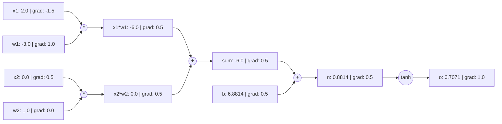

# 自動微分学習プロジェクトガイド (Automatic Differentiation Learning Project Guide)

**言語エディション (Language Edition):** 日本語 (Japanese / `ja`)  
**プロジェクト識別子 (Project Slug):** `autograd-learning-project`  
**実行コマンド (CLI Seam):** `python3 projects/autograd/cli.py`

---

## 1. コア概念と計算グラフの原理 (Core Concepts & Computational Graph)

ディープラーニングにおけるバックプロパゲーション (誤差逆伝播法) の本質は、**リバースモード自動微分 (Reverse-Mode Automatic Differentiation)** です。実行時に計算を動的に追跡することで、プログラムは**有向非巡回グラフ (Directed Acyclic Graph, DAG)** を構築します。

### 1.1 ノードの構造 (`Value` クラス)
各計算ノード `Value` は以下の属性を保持します：
- `data` (float): 順伝播で算出されたスカラー値。
- `grad` (float): 損失スカラー $L$ に対する当該変数の偏微分 $\frac{\partial L}{\partial x}$ (初期値は `0.0`)。
- `_prev` (Set[Value]): 直前の入力親ノードの集合。
- `_op` (str): ノードを生成した演算子記号 (`+`, `*`, `tanh` など)。
- `_backward` (Callable): 局所的な連鎖律ステップを実行するクロージャ。



---

## 2. 数学的導出と局所微分一覧 (Mathematical Derivations)

多変数微積分における多変数連鎖律によれば、変数 $x$ が後続ノード $y_1, y_2, \dots, y_k$ に分岐して影響を与え、最終目的スカラーが $L$ であるとき：
$$\frac{\partial L}{\partial x} = \sum_{j=1}^{k} \frac{\partial L}{\partial y_j} \frac{\partial y_j}{\partial x}$$

このため、逆伝播処理では**勾配の加算蓄積 (`self.grad += ...`)** が必須です。誤って代入 (`=`) を行うと、複数経路の勾配が上書きされて消失してしまいます。

### サポート演算子の局所微分一覧

| 演算 $f(x, y)$ | 順伝播式 | 局所微分 $\frac{\partial f}{\partial x}$ | 局所微分 $\frac{\partial f}{\partial y}$ | 制約および定義域 |
|---|---|---|---|---|
| 加算 $x + y$ | $x + y$ | $1$ | $1$ | なし |
| 減算 $x - y$ | $x - y$ | $1$ | $-1$ | なし |
| 乗算 $x \cdot y$ | $x \cdot y$ | $y$ | $x$ | なし |
| 除算 $x / y$ | $x \cdot y^{-1}$ | $\frac{1}{y}$ | $-\frac{x}{y^2}$ | 分母 $y \ne 0$ |
| 累乗 $x^n$ | $x^n$ | $n x^{n-1}$ | — | 指数 $n \in \mathbb{R}$ |
| 指数関数 $\exp(x)$ | $e^x$ | $e^x$ | — | $x > 700$ によるオーバーフロー注意 |
| 自然対数 $\ln(x)$ | $\ln(x)$ | $\frac{1}{x}$ | — | 定義域 $x > 0$ (`ValueError` 送出) |
| 活性化関数 $\text{ReLU}(x)$ | $\max(0, x)$ | $\begin{cases} 1 & x > 0 \\ 0 & x \le 0 \end{cases}$ | — | $x=0$ で微分不能 (劣勾配規約: 0) |
| 活性化関数 $\tanh(x)$ | $\frac{e^{2x}-1}{e^{2x}+1}$ | $1 - \tanh^2(x)$ | — | 数値安定域 $[-20, 20]$ |

---

## 3. 独立した数値勾配検査 (Finite Difference Gradcheck)

### 3.1 両側中心差分公式
$$\frac{\partial L}{\partial x} \approx \frac{L(x + h) - L(x - h)}{2h}$$
片側前進差分 $\frac{L(x+h) - L(x)}{h}$ (打ち切り誤差 $\mathcal{O}(h)$) と比較して、中心差分は $\mathcal{O}(h^2)$ の高精度な近似を提供します。

### 3.2 許容誤差ポリシー (Tolerances)
浮動小数点計算 (IEEE 754 64bit float) に基づく許容誤差基準：
$$\text{Relative Error} = \frac{|g_{\text{analytical}} - g_{\text{numerical}}|}{\max(|g_{\text{analytical}}|, |g_{\text{numerical}}|, \epsilon)} \le \text{rtol}$$
- 標準設定：$h = 10^{-5}, \text{rtol} = 10^{-3}, \text{atol} = 10^{-5}, \epsilon = 10^{-7}$。

### 3.3 微分不能点 (Kink Disclosure)
$x = 0.0$ における $\text{ReLU}$：
- 数値中心差分：$\frac{\max(0, h) - \max(0, -h)}{2h} = \frac{h - 0}{2h} = 0.5$。
- 解析的劣勾配規約：$0.0$。
- この差異は数学的特異点 (キンク) に起因する固有現象であり、プログラムの不具合ではありません。プロジェクトの Gradcheck はこの状況を明示的に開示します。

---

## 4. 勾配不具合の診断実演 (Observable Failing-Gradient Diagnosis)

### 典型的なバグ：勾配上書きの罠 (Overwrite Bug)
分岐グラフ $f = (a + b) \cdot a$ では、変数 $a$ が加算と乗算の双方に関与します。
もし `_backward` の実装が誤って代入になっている場合：
```python
# 意図的な不具合の例
def _backward():
    self.grad = 1.0 * out.grad  # 前の分岐で蓄積された勾配を上書きしてしまう！
```
診断コマンドを実行します：
```bash
python3 projects/autograd/cli.py diagnose --bug-type overwrite-accumulation
```
出力は以下を明確に特定します：
- ノード `a` の解析勾配が $7.0$ であるのに対し、数値差分の真値は $10.0$ (相対誤差 $30\%$)。
- 根本原因：DAG の複数分岐における勾配の蓄積漏れ。
- 修正方針：`=` を `+=` に変更する。

---

## 5. 演習問題・ヒント・模範解答 (Exercises, Hints & Answers)

### 演習 1：手計算と自動微分の照合
$x=1.5, y=-2.0$ における合成関数 $f(x, y) = (x \cdot y + 2)^2$ の勾配を手計算で求めなさい。
- **ヒント**: $u = x \cdot y + 2$ とおき、$f = u^2$ として連鎖律 $\frac{\partial f}{\partial u}$ と $\frac{\partial u}{\partial x}$ を適用します。
- **模範解答**:
  $u = 1.5 \times (-2.0) + 2 = -1.0$。
  $f = (-1.0)^2 = 1.0$。
  $\frac{\partial f}{\partial u} = 2u = -2.0$。
  $\frac{\partial f}{\partial x} = \frac{\partial f}{\partial u} \cdot y = (-2.0) \cdot (-2.0) = 4.0$。
  $\frac{\partial f}{\partial y} = \frac{\partial f}{\partial u} \cdot x = (-2.0) \cdot 1.5 = -3.0$。

### 演習 2：Sigmoid 演算子の実装
基本演算を組み合わせて Sigmoid 活性化関数 $\sigma(x) = \frac{1}{1 + e^{-x}}$ を構築しなさい。
- **ヒント**: $\sigma(x) = (1 + (-x).\exp()).\text{pow}(-1)$。微分は $\sigma(x)(1 - \sigma(x))$。
- **参考実装**:
```python
def sigmoid(x: Value) -> Value:
    return (1.0 + (-x).exp()) ** -1.0
```

---

## 6. AI 非依存の独立達成基準 (AI-Free Independent Mastery Criteria)

AI による自動生成に頼らず独立した理解を証明するため、学習者は以下を達成できる必要があります：
1. **ホワイトボード導出**: 分岐計算グラフの連鎖律を手書きで導出し、なぜ `+=` による加算蓄積が必須であるかを説明できること。
2. **スクラッチ実装**: プレーンテキストエディタで `__add__`, `__mul__`, トポロジカルソート, `backward()` を備えた `Value` クラスを独力で実装できること。
3. **独立したデバッグ**: 数値中心差分を用いて勾配不具合を検出し、その原因を特定して修正できること。

*注：本プロジェクトはスカラー自動微分の基礎理解を目的としています。本プロジェクトの完了は、PyTorch などのテンソル/分散学習システム全体の受入を意味するものではありません。*
