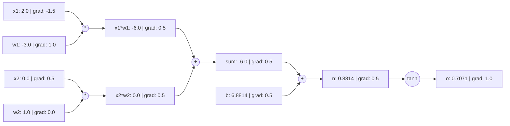

# 自动求导学习项目指南 (Automatic Differentiation Project Guide)

**语言版本 (Language Edition):** 简体中文 (Simplified Chinese)  
**项目标识 (Project Slug):** `autograd-learning-project`  
**核心命令 (CLI Seam):** `python3 projects/autograd/cli.py`

---

## 1. 核心概念与计算图原理 (Core Concepts & Computational Graph)

在深度学习中，反向传播算法 (Backpropagation) 的本质是**逆向模式自动微分 (Reverse-Mode Automatic Differentiation)**。通过在运行时动态追踪运算，程序构建起一个**有向无环图 (Directed Acyclic Graph, DAG)**。

### 1.1 节点属性 (Value Class)
每个计算节点 `Value` 包含：
- `data` (float): 前向计算产生的标量数值。
- `grad` (float): 损失标量 $L$ 对该节点变量的偏导数 $\frac{\partial L}{\partial x}$，初始化为 `0.0`。
- `_prev` (Set[Value]): 直接依赖的输入父节点集合。
- `_op` (str): 产生该节点的算子标识符（如 `+`, `*`, `tanh`）。
- `_backward` (Callable): 单步局部链式求导闭包。



---

## 2. 数学推导与算子导数表 (Mathematical Derivations)

多元微积分的多元链式法则表明：如果变量 $x$ 影响多个后续节点 $y_1, y_2, \dots, y_k$，且最终目标标量为 $L$，则：
$$\frac{\partial L}{\partial x} = \sum_{j=1}^{k} \frac{\partial L}{\partial y_j} \frac{\partial y_j}{\partial x}$$

这就是为什么反向传播必须使用**累加更新 (`self.grad += ...`)**，若错误写为赋值 (`=`)，分支路径的梯度将被覆盖！

### 支持算子的局部导数表

| 运算 $f(x, y)$ | 前向公式 | 局部偏导 $\frac{\partial f}{\partial x}$ | 局部偏导 $\frac{\partial f}{\partial y}$ | 边界与定义域约束 |
|---|---|---|---|---|
| 加法 $x + y$ | $x + y$ | $1$ | $1$ | 无 |
| 减法 $x - y$ | $x - y$ | $1$ | $-1$ | 无 |
| 乘法 $x \cdot y$ | $x \cdot y$ | $y$ | $x$ | 无 |
| 除法 $x / y$ | $x \cdot y^{-1}$ | $\frac{1}{y}$ | $-\frac{x}{y^2}$ | 分母 $y \ne 0$ |
| 幂运算 $x^n$ | $x^n$ | $n x^{n-1}$ | — | 指数 $n \in \mathbb{R}$ |
| 指数 $\exp(x)$ | $e^x$ | $e^x$ | — | 避免 $x > 700$ 浮点溢出 |
| 对数 $\ln(x)$ | $\ln(x)$ | $\frac{1}{x}$ | — | 定义域 $x > 0$，非正则抛出 `ValueError` |
| 激活 $\text{ReLU}(x)$ | $\max(0, x)$ | $\begin{cases} 1 & x > 0 \\ 0 & x \le 0 \end{cases}$ | — | $x=0$ 处不可导（次梯度约定为 0） |
| 激活 $\tanh(x)$ | $\frac{e^{2x}-1}{e^{2x}+1}$ | $1 - \tanh^2(x)$ | — | 数值稳定范围 $[-20, 20]$ |

---

## 3. 独立数值梯度检验 (Finite Difference Gradcheck)

### 3.1 双边中心差分公式
$$\frac{\partial L}{\partial x} \approx \frac{L(x + h) - L(x - h)}{2h}$$
相比单边前向差分 $\frac{L(x+h) - L(x)}{h}$（截断误差为 $\mathcal{O}(h)$），双边中心差分的截断误差为 $\mathcal{O}(h^2)$。

### 3.2 误差容限策略 (Tolerances)
浮点计算（IEEE 754 双精度 float64）受截断与舍入误差影响：
$$\text{Relative Error} = \frac{|g_{\text{analytical}} - g_{\text{numerical}}|}{\max(|g_{\text{analytical}}|, |g_{\text{numerical}}|, \epsilon)} \le \text{rtol}$$
- 默认设置：$h = 10^{-5}, \text{rtol} = 10^{-3}, \text{atol} = 10^{-5}, \epsilon = 10^{-7}$。

### 3.3 不可导尖点 (Kink Disclosure)
对于 $\text{ReLU}$ 在 $x=0.0$：
- 双边数值差分：$\frac{\max(0, 0+h) - \max(0, 0-h)}{2h} = \frac{h - 0}{2h} = 0.5$。
- 解析求导（次梯度）：约定为 $0.0$。
- 差异是由数学尖点不可导性导致的固有现象，而非程序缺陷。项目 Gradcheck 会对尖点显式披露。

---

## 4. 可观察的梯度失败诊断案例 (Observable Failing-Gradient Diagnosis)

### 典型缺陷：梯度覆盖陷阱 (Overwrite Bug)
在分支计算图 $f = (a + b) \cdot a$ 中，变量 $a$ 既参与了加法，又参与了乘法。
若 `_backward` 误写为：
```python
# 错误示范 (Buggy)
def _backward():
    self.grad = 1.0 * out.grad  # 覆盖了此前分支计算的梯度！
```
运行诊断命令：
```bash
python3 projects/autograd/cli.py diagnose --bug-type overwrite-accumulation
```
输出将明确指出：
- 节点 `a` 的解析梯度为 $7.0$，而数值差分真实梯度为 $10.0$（误差高达 $30\%$）。
- 根本原因：未能应用多元链式法则累加梯度。
- 修复方案：将 `=` 改为 `+=`。

---

## 5. 练习题、提示与参考答案 (Exercises, Hints & Answers)

### 练习 1：手算与自动求导对比
计算复合函数 $f(x, y) = (x \cdot y + 2)^2$ 在 $x=1.5, y=-2.0$ 处的梯度。
- **提示**：令 $u = x \cdot y + 2$，则 $f = u^2$。先求 $\frac{\partial f}{\partial u}$，再求 $\frac{\partial u}{\partial x}$。
- **参考答案**：
  $u = 1.5 \times (-2.0) + 2 = -1.0$。
  $f = (-1.0)^2 = 1.0$。
  $\frac{\partial f}{\partial u} = 2u = -2.0$。
  $\frac{\partial f}{\partial x} = \frac{\partial f}{\partial u} \cdot y = (-2.0) \cdot (-2.0) = 4.0$。
  $\frac{\partial f}{\partial y} = \frac{\partial f}{\partial u} \cdot x = (-2.0) \cdot 1.5 = -3.0$。

### 练习 2：Sigmoid 算子扩展
基于现有算子实现 Sigmoid 激活函数：$\sigma(x) = \frac{1}{1 + e^{-x}}$。
- **提示**：$\sigma(x) = (1 + (-x).\exp()).\text{pow}(-1)$。其导数为 $\sigma(x)(1 - \sigma(x))$。
- **参考实现**：
```python
def sigmoid(x: Value) -> Value:
    return (1.0 + (-x).exp()) ** -1.0
```

---

## 6. 无 AI 辅助的独立掌握标准 (AI-Free Independent Mastery Criteria)

为了确保证明独立理解，学员应当能够在无 AI 生成辅助的情况下：
1. **白板推导**：独立手写分支计算图的反向传播链式法则，推导出为何必须使用 `+=` 累加。
2. **手写核心引擎**：在纯文本编辑器中独立实现包含 `__add__`、`__mul__`、`topological_sort` 和 `backward` 的 `Value` 类。
3. **独立调试**：使用双边数值差分定位出梯度错误节点，并指出为何该节点解析梯度与数值梯度不匹配。

*注意：本学习项目旨在深刻理解标量级反向传播原理。掌握本项目并不等于已验收完整的分布式或张量级深度学习框架（如 PyTorch/JAX）。*
