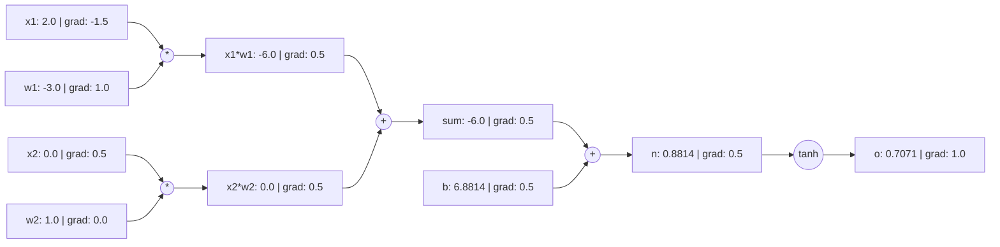

# 自動求導學習項目指南 (Automatic Differentiation Project Guide)

**語言版本 (Language Edition):** 繁體中文 (Traditional Chinese)  
**項目標識 (Project Slug):** `autograd-learning-project`  
**核心命令 (CLI Seam):** `python3 projects/autograd/cli.py`

---

## 1. 核心概念與計算圖原理 (Core Concepts & Computational Graph)

在深度學習中，反向傳播演算法 (Backpropagation) 的本質是**逆向模式自動微分 (Reverse-Mode Automatic Differentiation)**。透過在執行時期動態追蹤運算，程式建構起一個**有向無環圖 (Directed Acyclic Graph, DAG)**。

### 1.1 節點屬性 (Value Class)
每個計算節點 `Value` 包含：
- `data` (float): 前向計算產生的純量數值。
- `grad` (float): 損失純量 $L$ 對該節點變數的偏導數 $\frac{\partial L}{\partial x}$，初始化為 `0.0`。
- `_prev` (Set[Value]): 直接依賴的輸入父節點集合。
- `_op` (str): 產生該節點的算子識別碼（如 `+`, `*`, `tanh`）。
- `_backward` (Callable): 單步局部鏈式求導閉包。



---

## 2. 數學推導與算子導數表 (Mathematical Derivations)

多元微積分的多元鏈式法則表明：若變數 $x$ 影響多個後續節點 $y_1, y_2, \dots, y_k$，且最終目標純量為 $L$，則：
$$\frac{\partial L}{\partial x} = \sum_{j=1}^{k} \frac{\partial L}{\partial y_j} \frac{\partial y_j}{\partial x}$$

這就是為什麼反向傳播必須使用**累加更新 (`self.grad += ...`)**，若錯誤寫為賦值 (`=`)，分支路徑的梯度將被覆蓋！

### 支援算子的局部導數表

| 運算 $f(x, y)$ | 前向公式 | 局部偏導 $\frac{\partial f}{\partial x}$ | 局部偏導 $\frac{\partial f}{\partial y}$ | 邊界與定義域約束 |
|---|---|---|---|---|
| 加法 $x + y$ | $x + y$ | $1$ | $1$ | 無 |
| 減法 $x - y$ | $x - y$ | $1$ | $-1$ | 無 |
| 乘法 $x \cdot y$ | $x \cdot y$ | $y$ | $x$ | 無 |
| 除法 $x / y$ | $x \cdot y^{-1}$ | $\frac{1}{y}$ | $-\frac{x}{y^2}$ | 分母 $y \ne 0$ |
| 次方運算 $x^n$ | $x^n$ | $n x^{n-1}$ | — | 指數 $n \in \mathbb{R}$ |
| 指數 $\exp(x)$ | $e^x$ | $e^x$ | — | 避免 $x > 700$ 浮點溢位 |
| 對數 $\ln(x)$ | $\ln(x)$ | $\frac{1}{x}$ | — | 定義域 $x > 0$，非正則拋出 `ValueError` |
| 激活 $\text{ReLU}(x)$ | $\max(0, x)$ | $\begin{cases} 1 & x > 0 \\ 0 & x \le 0 \end{cases}$ | — | $x=0$ 處不可導（次梯度約定為 0） |
| 激活 $\tanh(x)$ | $\frac{e^{2x}-1}{e^{2x}+1}$ | $1 - \tanh^2(x)$ | — | 數值穩定範圍 $[-20, 20]$ |

---

## 3. 獨立數值梯度檢驗 (Finite Difference Gradcheck)

### 3.1 雙邊中心差分公式
$$\frac{\partial L}{\partial x} \approx \frac{L(x + h) - L(x - h)}{2h}$$
相比單邊前向差分 $\frac{L(x+h) - L(x)}{h}$（截斷誤差為 $\mathcal{O}(h)$），雙邊中心差分的截斷誤差為 $\mathcal{O}(h^2)$。

### 3.2 誤差容限策略 (Tolerances)
浮點計算（IEEE 754 雙精度 float64）受截斷與捨入誤差影響：
$$\text{Relative Error} = \frac{|g_{\text{analytical}} - g_{\text{numerical}}|}{\max(|g_{\text{analytical}}|, |g_{\text{numerical}}|, \epsilon)} \le \text{rtol}$$
- 預設設定：$h = 10^{-5}, \text{rtol} = 10^{-3}, \text{atol} = 10^{-5}, \epsilon = 10^{-7}$。

### 3.3 不可導尖點 (Kink Disclosure)
對於 $\text{ReLU}$ 在 $x=0.0$：
- 雙邊數值差分：$\frac{\max(0, 0+h) - \max(0, 0-h)}{2h} = \frac{h - 0}{2h} = 0.5$。
- 解析求導（次梯度）：約定為 $0.0$。
- 差異是由數學尖點不可導性導致的固有現象，而非程式缺陷。項目 Gradcheck 會對尖點顯式揭露。

---

## 4. 可觀察的梯度失敗診斷案例 (Observable Failing-Gradient Diagnosis)

### 典型缺陷：梯度覆蓋陷阱 (Overwrite Bug)
在分支計算圖 $f = (a + b) \cdot a$ 中，變數 $a$ 既參與了加法，又參與了乘法。
若 `_backward` 誤寫為：
```python
# 錯誤示範 (Buggy)
def _backward():
    self.grad = 1.0 * out.grad  # 覆蓋了此前分支計算的梯度！
```
執行診斷命令：
```bash
python3 projects/autograd/cli.py diagnose --bug-type overwrite-accumulation
```
輸出將明確指出：
- 節點 `a` 的解析梯度為 $7.0$，而數值差分真實梯度為 $10.0$（誤差高達 $30\%$）。
- 根本原因：未能應用多元鏈式法則累加梯度。
- 修復方案：將 `=` 改為 `+=`。

---

## 5. 練習題、提示與參考答案 (Exercises, Hints & Answers)

### 練習 1：手算與自動求導對比
計算複合函數 $f(x, y) = (x \cdot y + 2)^2$ 在 $x=1.5, y=-2.0$ 處的梯度。
- **提示**：令 $u = x \cdot y + 2$，則 $f = u^2$。先求 $\frac{\partial f}{\partial u}$，再求 $\frac{\partial u}{\partial x}$。
- **參考答案**：
  $u = 1.5 \times (-2.0) + 2 = -1.0$。
  $f = (-1.0)^2 = 1.0$。
  $\frac{\partial f}{\partial u} = 2u = -2.0$。
  $\frac{\partial f}{\partial x} = \frac{\partial f}{\partial u} \cdot y = (-2.0) \cdot (-2.0) = 4.0$。
  $\frac{\partial f}{\partial y} = \frac{\partial f}{\partial u} \cdot x = (-2.0) \cdot 1.5 = -3.0$。

### 練習 2：Sigmoid 算子擴充
基於現有算子實現 Sigmoid 激活函數：$\sigma(x) = \frac{1}{1 + e^{-x}}$。
- **提示**：$\sigma(x) = (1 + (-x).\exp()).\text{pow}(-1)$。其導數為 $\sigma(x)(1 - \sigma(x))$。
- **參考實現**：
```python
def sigmoid(x: Value) -> Value:
    return (1.0 + (-x).exp()) ** -1.0
```

---

## 6. 無 AI 輔助的獨立掌握標準 (AI-Free Independent Mastery Criteria)

為了確保證明獨立理解，學員應當能夠在無 AI 生成輔助的情況下：
1. **白板推導**：獨立手寫分支計算圖的反向傳播鏈式法則，推導出為何必須使用 `+=` 累加。
2. **手寫核心引擎**：在純文字編輯器中獨立實現包含 `__add__`、`__mul__`、`topological_sort` 和 `backward` 的 `Value` 類別。
3. **獨立除錯**：使用雙邊數值差分定位出梯度錯誤節點，並指出為何該節點解析梯度與數值梯度不相符。

*注意：本學習項目旨在深刻理解純量級反向傳播原理。掌握本項目並不等於已驗收完整的分散式或張量級深度學習框架（如 PyTorch/JAX）。*
